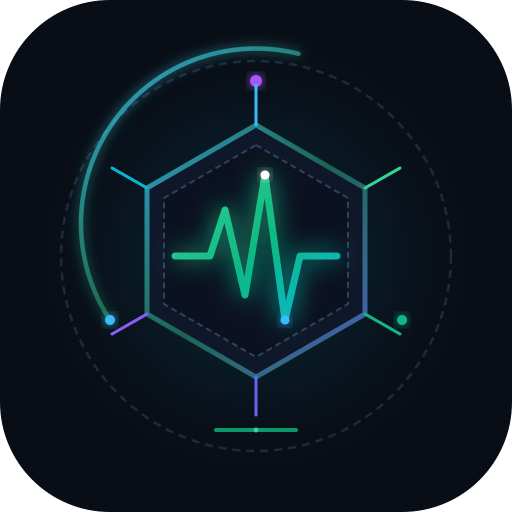

<div align="center">

  

  # OptiPulse ⚡

  ### Universal Hardware Telemetry, RAM Optimizer & AI Readiness Engine
  **The high-performance workstation diagnostic tool for Windows, macOS & Linux.**

  [](LICENSE)
  [](https://www.python.org/)
  [](#-platform-support)
  [](#-user-interface)
  [](#)

  <p align="center">
    <a href="#-quick-start">Quick Start</a> •
    <a href="#-core-features">Features</a> •
    <a href="#-actionable-optimization-advisor">Advisor Engine</a> •
    <a href="#-developer-use-cases">Use Cases</a> •
    <a href="#-cross-platform-architecture">Architecture</a> •
    <a href="#-contributing">Contributing</a>
  </p>

</div>

---

## 🌟 What is OptiPulse?

**OptiPulse** is an open-source, zero-external-dependency workstation auditing and memory optimization engine. It audits your physical silicon, memory bandwidth, thermal governors, and AI tooling stack, providing:

1. **Live Optimization Score (0–100)**: Evaluates your machine against developer workstation best practices.
2. **1-Click Universal RAM Flush**: Safely releases gigabytes of inactive application working sets and standby caches across Windows, macOS, and Linux without closing your workspace.
3. **Hardware Bottleneck Detection**: Automatically identifies single-channel memory bottlenecks, disk paging thrash, power governor throttles, and GPU driver mismatches.
4. **AI & Dev Stack Readiness**: Checks PyTorch CUDA 12.x / Apple Silicon Metal (MPS) acceleration, local Ollama LLM daemons, and Docker environments.

---

## 🖥️ User Interface

OptiPulse ships with an ultra-responsive, dark-mode glassmorphism dashboard running locally with zero bloat:

```
+-------------------------------------------------------------------------------+
|  ⚡ OptiPulse        [ Windows 11 AMD64 ]  ● LIVE                [ Purge RAM ]|
+-------------------------------------------------------------------------------+
|                                                                               |
|     ( 100 )   WORKSTATION PERFORMANCE STATUS                                  |
|     / 100     All subsystems operating at peak throughput.                    |
|               0 swap thrashing, dual-channel bus engaged, CUDA active.        |
|                                                                               |
+-------------------+-------------------+-------------------+-------------------+
| 🧠 RAM & BANDWIDTH| ⚡ CPU & GOVERNOR | 🎮 GPU ACCEL      | 🤖 AI STACK       |
| 15.37 GB (7.0 GB) | Ryzen 5 4600H     | GTX 1650 Ti (45C) | PyTorch 2.6+cu124 |
| Dual-Channel 3.2G | Ultimate Perf     | 3,935 MB Free     | CUDA Operational  |
| 0 pages/sec swap  | 6 Cores / 12 Thr  | Driver 617.42     | Ollama Daemon OK  |
+-------------------+-------------------+-------------------+-------------------+
|                                                                               |
|  🎯 ACTIONABLE OPTIMIZATION PLAYBOOK                                          |
|  [OPTIMAL]  High-Bandwidth Bus: Dual-Channel (2 DIMMs @ 3200MHz)              |
|  [OPTIMAL]  Zero Paging Bottleneck (0 Pages/Sec Swapping)                     |
|  [OPTIMAL]  Hardware CUDA Acceleration Active (NVIDIA GTX 1650 Ti)            |
|  [TIP]      Ollama Local Model Engine: Ready for offline LLM inference        |
+-------------------------------------------------------------------------------+
```

---

## 🚀 Quick Start

OptiPulse runs immediately using Python 3.8+ or direct platform launch scripts.

### 🪟 Windows Installation & Usage

**Method 1: 1-Click Launchers (Zero Terminal)**
1. Clone or download this repository.
2. Double-click [`scripts/windows/run.bat`](scripts/windows/run.bat) to launch the native dashboard.
3. Use [`scripts/windows/clean_ram.bat`](scripts/windows/clean_ram.bat) for an instant 1-click desktop RAM flush.

**Method 2: Command Line**
```powershell
# Clone the repository
git clone https://github.com/<your-username>/OptiPulse.git
cd OptiPulse

# Optional: Install psutil for enhanced sensor precision
pip install -r requirements.txt

# Run Web UI Dashboard
python -m optipulse

# Run Terminal CLI Report
python -m optipulse --cli

# Instant RAM Flush only
python -m optipulse --clean-ram
```

---

### 🍎 macOS Installation & Usage

OptiPulse natively supports **Apple Silicon (M1/M2/M3/M4)** and Intel Macs with Metal Performance Shaders (MPS) detection:

**Method 1: 1-Click Finder Runner**
1. Double-click [`scripts/macos/run.command`](scripts/macos/run.command).

**Method 2: Terminal**
```bash
git clone https://github.com/<your-username>/OptiPulse.git
cd OptiPulse

# Make scripts executable
chmod +x scripts/macos/*.sh scripts/macos/*.command

# Launch
python3 -m optipulse
```

---

### 🐧 Linux Installation & Usage (Ubuntu, Debian, Fedora, Arch)

```bash
git clone https://github.com/<your-username>/OptiPulse.git
cd OptiPulse

chmod +x scripts/linux/*.sh

# Run Web Dashboard
./scripts/linux/run.sh

# Or run headlessly over SSH
python3 -m optipulse --cli
```

---

## 💡 Core Features

| Feature | Windows | macOS | Linux | What It Does |
| :--- | :---: | :---: | :---: | :--- |
| **Instant RAM Purge** | ✅ Win32 API | ✅ `purge` | ✅ Buffer Sync | Trims unreferenced memory pages and frees standby cache without closing apps. |
| **Dual-Channel Audit** | ✅ CIM/WMI | ✅ UMA Bus | ✅ DMI decode | Verifies whether your system is running in 64-bit single channel or 128-bit dual channel. |
| **Paging & Swap Monitor**| ✅ Perf Counters | ✅ `vm_stat` | ✅ `/proc/meminfo`| Detects active disk thrashing before your start menu or terminal begins to lag. |
| **GPU & Acceleration** | ✅ NVIDIA/Intel | ✅ Metal 3 UMA | ✅ ROCm/NVIDIA | Tracks temperatures, VRAM free space, and CUDA/MPS backend readiness. |
| **AI Stack Readiness** | ✅ CUDA 12.x | ✅ PyTorch MPS | ✅ ROCm/CUDA | Verifies PyTorch hardware acceleration, local Ollama models, and Docker daemons. |
| **0-100 Scoring Engine**| ✅ Dynamic | ✅ Dynamic | ✅ Dynamic | Deducts points for configuration flaws and provides exact copy-paste remediation commands. |

---

## 🎯 Actionable Optimization Advisor

OptiPulse does not just report numbers; it acts as a senior system engineer analyzing your machine:

* **Memory Bandwidth Bottlenecks**: Detects single-channel RAM configurations that cut memory bandwidth by 50% and compilation throughput by up to 25%.
* **Disk Thrashing & Swap Latency**: Detects when pages/sec exceed safe limits and prompts you to flush working sets.
* **Power Governor Throttling**: Flags systems stuck on "Power Saver" or low-frequency scaling while connected to wall power.
* **PyTorch CPU-Only Warning**: Instantly alerts AI practitioners if PyTorch was mistakenly installed without CUDA or MPS acceleration.
* **NVMe SLC Cache Protection**: Warns when primary disk storage exceeds 85%, which cripples SSD burst write performance.

---

## 💼 Developer Use Cases

### 1. 🤖 AI & Machine Learning Engineers
* **Problem**: You run `import torch` and train a model, only to realize hours later that PyTorch was silently running on the CPU because the wrong wheel was installed.
* **OptiPulse Solution**: Tests PyTorch compute capability, CUDA driver version, and free VRAM in real-time.

### 2. 💻 Full-Stack & Systems Developers
* **Problem**: Heavy IDEs (VS Code, JetBrains), 30+ Chrome tabs, and local Docker containers fill memory, forcing the OS to swap to disk and causing Start Menu and typing latency.
* **OptiPulse Solution**: One click on `Purge Inactive RAM` immediately flushes several gigabytes of inactive background memory pages without terminating active tasks.

### 3. 🧪 Workstation Benchmarking & Hardware Validation
* **Problem**: You just bought or upgraded a RAM stick, GPU, or SSD and need to confirm it is running at the advertised frequency and dual-channel symmetric mode.
* **OptiPulse Solution**: Immediate verification of clock frequencies (e.g. 3200 MHz), channel widths, and PCIe link health.

---

## 🏗️ Cross-Platform Architecture

```
                       +---------------------------------------+
                       |          OptiPulse Front-End          |
                       | (Dark Glassmorphism Dashboard / CLI)  |
                       +---------------------------------------+
                                           |
                                  REST API / Telemetry
                                           v
                       +---------------------------------------+
                       |        OptiPulse Local Server         |
                       |       (Zero-Dependency Python)        |
                       +---------------------------------------+
                                  |                 |
                   +--------------+                 +---------------+
                   v                                                v
    +-----------------------------+                  +-----------------------------+
    |     optipulse.core.audit    |                  |   optipulse.core.cleaner    |
    | - Hardware Sensor Polling   |                  | - Win32 EmptyWorkingSet     |
    | - Dual-Channel RAM Analysis |                  | - macOS Cache Purge         |
    | - GPU CUDA/MPS Telemetry    |                  | - Linux Dirty Buffer Sync   |
    +-----------------------------+                  +-----------------------------+
                   |
                   v
    +-----------------------------+
    |    optipulse.core.advisor   |
    | - 0-100 Score Calculation   |
    | - Technical Remediation     |
    | - Developer Impact Mapping  |
    +-----------------------------+
```

---

## 📦 Python Package Installation

OptiPulse can also be installed as a standard Python command-line utility:

```bash
# Install in editable mode
pip install -e .

# Launch anywhere
optipulse

# Run headless audit
optipulse --cli

# Instant RAM purge
optipulse --clean-ram
```

---

## 🤝 Contributing

Contributions are welcome! Please check out [CONTRIBUTING.md](CONTRIBUTING.md) for details on code style, architectural guidelines, and pull request workflows.

---

## 📄 License

OptiPulse is open-source software licensed under the [MIT License](LICENSE).
Feel free to use, modify, and distribute it for personal, academic, or commercial workstations.
